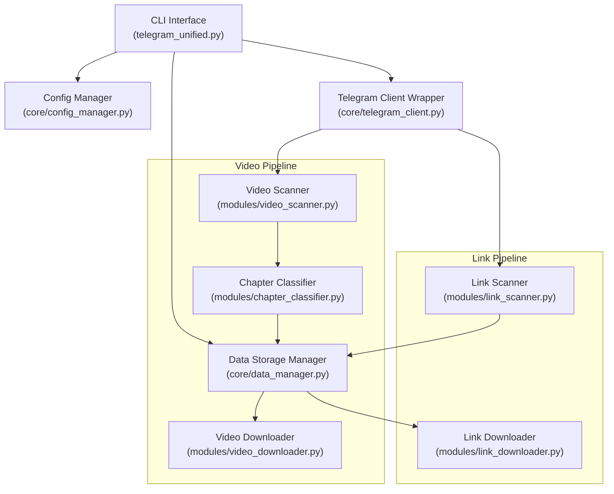

# ⚡ Telegram Tools Unified (Telegram Scraper)

[](https://www.python.org/)
[](https://github.com/LonamiWebs/Telethon)
[](https://github.com/yt-dlp/yt-dlp)
[](#license)

**Telegram Tools Unified** is a high-performance CLI utility designed to archive, categorize, and download content from Telegram channels and groups. It seamlessly merges **native Telegram video downloading** with **external media harvesting** (YouTube & Google Drive), backed by intelligent pattern-based chapter categorization, automated fuzzy matching, parallel worker pools, and resumable downloads.

---

## 📑 Table of Contents

- [Key Features](#-key-features)
- [System Architecture](#-system-architecture)
- [Prerequisites](#-prerequisites)
- [Installation & Setup](#-installation--setup)
- [Configuration Guide](#-configuration-guide)
- [Command Reference & Usage](#-command-reference--usage)
  - [1. Channel Management](#1-channel-management)
  - [2. Video Scanning & Classification](#2-video-scanning--classification)
  - [3. Video Downloads](#3-video-downloads)
  - [4. External Link Harvesting](#4-external-link-harvesting)
  - [5. External Link Downloads](#5-external-link-downloads)
  - [6. Utility & Maintenance Commands](#6-utility--maintenance-commands)
- [Directory Layout](#-directory-layout)
- [Performance & Worker Tuning](#-performance--worker-tuning)
- [Troubleshooting & FAQ](#-troubleshooting--faq)
- [Security & Best Practices](#-security--best-practices)
- [Documentation & Related Guides](#-documentation--related-guides)
- [Legal Notice & Disclaimer](#-legal-notice--disclaimer)

---

## 🌟 Key Features

### 🎥 Native Telegram Video Downloader
- **Channel & Group Scanning**: Collect video files from public usernames (`@channelname`) or private channel IDs (`-100...`).
- **Intelligent Chapter & Category Classifier**: Automatically groups videos by subject, lecture, or topic using message sequence analysis, caption parsing, and Levenshtein fuzzy distance matching.
- **Resumable Parallel Downloads**: Concurrent multi-worker downloading with customizable chunk sizes (`chunk_size_kb`) and state caching (`.dlstate`).
- **Real-Time Progress**: Live terminal bars powered by `tqdm` detailing download speed (MB/s), elapsed time, and ETA.

### 🔗 External Link Harvester
- **Multi-Platform Support**: Scans messages and extracts YouTube and Google Drive URLs with surrounding caption context.
- **Fast Parallel Fetching**: Concurrently resolves and downloads videos or folders using `yt-dlp` and `gdown` with 3–10× speedups.
- **Status Lifecycle Tracking**: Records link states (`pending`, `completed`, `failed`) and supports automated batch retries.

### 🛡️ Resilience & Fault Tolerance
- **FloodWait & Rate-Limit Backoff**: Intercepts Telegram API `FloodWaitError` and automatically waits or retries with exponential backoff.
- **2FA Ready**: Fully supports Two-Factor Authentication during session establishment.
- **JSON Database Engine**: Persists all scanned metadata in `.telegram_tools_data/`, eliminating redundant network queries.

---

## 🏗️ System Architecture



---

## 📋 Prerequisites

- **Python**: Version **3.10** or higher.
- **Telegram Account**: Phone number enabled for Telegram.
- **Telegram API Credentials**: An `api_id` and `api_hash` obtained from [my.telegram.org](https://my.telegram.org).
- **FFmpeg** *(Optional but recommended)*: Required by `yt-dlp` for post-processing and merging video streams.

---

## 🚀 Installation & Setup

1. **Clone the repository**:
   ```bash
   git clone https://github.com/ShihabulSakib/Telegram-Scraper-.git
   cd Telegram-Scraper-
   ```

2. **Create and activate a virtual environment**:
   ```bash
   python3 -m venv venv
   source venv/bin/activate
   # On Windows: venv\Scripts\activate
   ```

3. **Install dependencies**:
   ```bash
   pip install --upgrade pip
   pip install -r requirements.txt
   ```

4. **Initialize configuration**:
   ```bash
   cp config.json.example config.json
   ```

---

## ⚙️ Configuration Guide

Edit `config.json` with your credentials and preferences:

```json
{
  "api_id": "12345678",
  "api_hash": "0123456789abcdef0123456789abcdef",
  "phone": "+1234567890",
  "download_path": "downloads",
  "max_parallel_downloads": 3,
  "chunk_size_kb": 512,
  "max_retries": 5,
  "retry_delay_seconds": 3
}
```

### Parameter Reference

| Key | Type | Default | Description |
|---|---|---|---|
| `api_id` | `string` / `int` | *Required* | Telegram API App ID from [my.telegram.org](https://my.telegram.org). |
| `api_hash` | `string` | *Required* | Telegram API App Hash. |
| `phone` | `string` | *Required* | Phone number in full international E.164 format (e.g. `+1234567890`). |
| `download_path` | `string` | `"downloads"` | Destination folder for stored media. |
| `max_parallel_downloads` | `int` | `3` | Default concurrent worker pool size. |
| `chunk_size_kb` | `int` | `512` | Telethon chunk size for file streaming in kilobytes. |
| `max_retries` | `int` | `5` | Maximum retry attempts on network or timeout exceptions. |
| `retry_delay_seconds` | `int` | `3` | Base sleep delay between consecutive retry attempts. |

---

## 💻 Command Reference & Usage

The application is controlled via `telegram_unified.py`:

```bash
python telegram_unified.py <command> [options]
```

### 1. Channel Management

#### List Accessible Dialogs
Displays all joined channels and groups along with their entity IDs and usernames:
```bash
python telegram_unified.py list-channels
```

---

### 2. Video Scanning & Classification

#### Scan Channel for Videos
Scans messages in a target channel, identifies video documents, and runs the chapter classification engine:
```bash
# Scan a public channel by username
python telegram_unified.py scan-videos @channelname

# Limit the scan to the last 150 messages
python telegram_unified.py scan-videos @channelname --limit 150

# Scan a private channel by numeric ID
python telegram_unified.py scan-videos -1001234567890
```

#### List Scanned Videos
Inspect scanned items and review assigned categories:
```bash
# List all discovered videos
python telegram_unified.py list-videos

# Filter videos by caption or title keywords
python telegram_unified.py list-videos --filter "Lecture"

# Display videos belonging to a specific category
python telegram_unified.py list-videos --category "Physics"
```

---

### 3. Video Downloads

#### Download Scanned Videos by Category
Download video files using parallel worker threads:
```bash
# Download all videos from a specific category
python telegram_unified.py download-videos --category "Physics" --workers 3

# Download uncategorized videos
python telegram_unified.py download-videos --category "Uncategorized" --workers 2
```

---

### 4. External Link Harvesting

#### Scan Channel for External URLs
Scans channel history specifically for YouTube and Google Drive links:
```bash
# Scan public or private channel for external links
python telegram_unified.py scan-links @techNews --limit 200
```

#### List Collected Links
Review links stored in the local database:
```bash
# List all links
python telegram_unified.py list-links

# Filter by type (youtube | drive)
python telegram_unified.py list-links --type youtube

# Filter by search keyword
python telegram_unified.py list-links --filter "python tutorial"
```

---

### 5. External Link Downloads

#### Download Discovered Media
Invokes `yt-dlp` or `gdown` in parallel:
```bash
# Download all pending links across all platforms
python telegram_unified.py download-links --all --workers 4

# Download only YouTube links
python telegram_unified.py download-links --all --type youtube --workers 3

# Download only Google Drive links
python telegram_unified.py download-links --all --type drive --workers 4

# Download links matching a specific query
python telegram_unified.py download-links --filter "algorithm" --workers 3
```

---

### 6. Utility & Maintenance Commands

#### Global Health & Statistics Status
View an aggregated report of total items scanned, completed, and storage utilized:
```bash
python telegram_unified.py status
```

#### Reset Failed or Completed Links
Mark completed or errored links back to `pending` status for a clean retry:
```bash
# Reset all links
python telegram_unified.py reset-links --all

# Reset specific platform links
python telegram_unified.py reset-links --type drive
```

#### Category Reorganization
Rename or merge categories detected by the classification algorithm:
```bash
python telegram_unified.py rename-category --old "Ch1 Intro" --new "Chapter 01 - Introduction"
```

#### In-CLI Config Management
Read or update config values without manual JSON file editing:
```bash
# View active configuration
python telegram_unified.py config --show

# Update a setting
python telegram_unified.py config --set max_parallel_downloads=5
```

---

## 📂 Directory Layout

```text
Telegram-Scraper-/
├── telegram_unified.py       # Main CLI application entrypoint
├── config.json.example       # Template configuration file
├── requirements.txt          # Python dependencies
├── QUICKSTART.md             # 5-minute fast setup guide
├── TROUBLESHOOTING.md       # Comprehensive error-resolution handbook
├── BUGFIX.md                 # Detailed changelog of resolved issues
├── TEST_RESULTS.md           # Verification tests & benchmarks
│
├── core/                     # Foundational subsystems
│   ├── config_manager.py     # Schema loader and validation
│   ├── telegram_client.py    # Telethon wrapper & session handler
│   └── data_manager.py       # Local JSON database manager
│
├── modules/                  # Specialized feature modules
│   ├── chapter_classifier.py # Fuzzy sequence & checkpoint classifier
│   ├── video_scanner.py      # Telethon message scanner for video media
│   ├── video_downloader.py   # Resumable parallel video downloader
│   ├── link_scanner.py       # Regex extractor for YouTube/Drive URLs
│   └── link_downloader.py    # Parallel engine for yt-dlp & gdown
│
└── utils/                    # Helper utilities
    ├── progress_display.py   # Formatting and terminal metrics
    ├── error_handler.py      # Retry logic & FloodWait management
    └── validators.py         # Identifier and argument sanitizers
```

---

## ⚡ Performance & Worker Tuning

| Worker Count | Network Speed | Risk Profile | Best Use Case |
|:---:|:---:|:---:|---|
| **1 – 2** | Low / Mobile hotspot | 🟢 Ultra-safe | Slow networks, strict rate-limit prevention |
| **3 – 4** | Standard Broadband | ⭐ **Optimal** | Best balance between throughput and API stability |
| **5 – 6** | High-speed Fiber | 🟡 Moderate | Large batch downloading; keep an eye on FloodWait |
| **7+** | High-speed Dedicated | 🔴 High Risk | May trigger temporary IP or Telegram cooldowns |

> [!TIP]
> Always begin with `--limit 50` when scanning a new channel to confirm categorization accuracy before initiating massive download queues.

---

## 🛠️ Troubleshooting & FAQ

### 1. `config.json not found`
Copy the sample file and enter your credentials:
```bash
cp config.json.example config.json
```

### 2. `ValueError: Cannot find any entity corresponding to "-100..."`
Ensure you are an active member of the channel or group. Use `python telegram_unified.py list-channels` to fetch the verified entity ID. Channel IDs must begin with `-100` for supergroups and channels.

### 3. `FloodWaitError: A wait of X seconds is required`
Telegram rate limits rapid sequential API queries. The tool will automatically pause and resume. If this happens frequently, lower the `--workers` flag to `2` or `3`.

### 4. `SessionPasswordNeededError`
Your Telegram account has Two-Factor Authentication (2FA) enabled. Enter your password when prompted in the terminal. The session is cached locally in `.session` and will not prompt again.

For an extensive list of errors and solutions, see [TROUBLESHOOTING.md](TROUBLESHOOTING.md).

---

## 🔒 Security & Best Practices

- **Protect `config.json`**: This file contains your private API credentials. Never commit this file to public repositories.
- **Protect `*.session` files**: The session file generated upon login contains your active authorization token.
- **Recommended `.gitignore` items**:
  ```gitignore
  config.json
  *.session
  *.session-journal
  .telegram_tools_data/
  downloads/
  __pycache__/
  *.pyc
  venv/
  ```

---

## 📚 Documentation & Related Guides

- [QUICKSTART.md](QUICKSTART.md) — Fast-track setup for immediate usage.
- [TROUBLESHOOTING.md](TROUBLESHOOTING.md) — Complete error catalog and mitigation strategies.
- [BUGFIX.md](BUGFIX.md) — Detailed notes on entity conversion fixes and updates.
- [TEST_RESULTS.md](TEST_RESULTS.md) — Execution logs and test outcomes.

---

## ⚖️ Legal Notice & Disclaimer

This project is developed for personal archival and educational purposes. Ensure you have the necessary authorization and rights before downloading copyrighted media. The authors and contributors are not liable for any misuse of this software or violations of Telegram's Terms of Service.

---

<div align="center">
  <sub>Made with ❤️ for Telegram power users.</sub>
</div>
